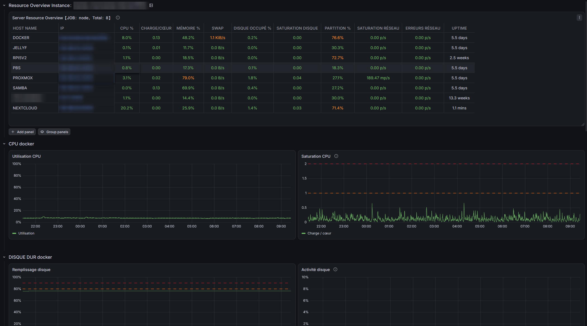

# Vue d'ensemble USE – serveurs et VM (Prometheus + Grafana)

Tableau de bord Grafana pour superviser plusieurs serveurs et machines virtuelles avec **node_exporter**, organisé selon la **méthode USE** (Utilisation, Saturation, Erreurs).



## Le principe

- **En haut, une ligne par machine.** Les colonnes sont rangées par ressource (CPU, mémoire, disque, réseau) et, pour chacune, dans l'ordre utilisation → saturation → erreurs. Les valeurs passent au orange puis au rouge selon des seuils : une machine en difficulté se repère d'un coup d'œil.
- **En dessous, le détail de la machine choisie.** Un clic sur l'IP d'une ligne affiche ses courbes CPU, mémoire, disque et réseau.

La méthode USE consiste à poser trois questions pour chaque ressource :

| | Question | Exemple |
|---|---|---|
| **Utilisation** | La ressource travaille-t-elle ? | CPU %, mémoire % |
| **Saturation** | Du travail attend-il ? | charge par cœur, swap, file d'attente disque, paquets jetés |
| **Erreurs** | La ressource fonctionne-t-elle mal ? | erreurs réseau |

Une utilisation élevée n'est un problème que si la saturation suit : une mémoire à 80 % sans swap est saine, une mémoire à 80 % qui swappe ne l'est pas.

## Colonnes de la vue d'ensemble

| Colonne | Ressource | Type USE | Orange / Rouge |
|---|---|---|---|
| CPU % | CPU | Utilisation | 70 / 85 |
| CHARGE/CŒUR | CPU | Saturation | 1 / 2 |
| MÉMOIRE % | Mémoire | Utilisation | 70 / 85 |
| SWAP | Mémoire | Saturation | 1 Kio/s / 1 Mio/s |
| DISQUE OCCUPÉ % | Disque | Utilisation | 80 / 90 |
| SATURATION DISQUE | Disque | Saturation (file d'attente) | 1 / 2 |
| PARTITION % | Disque | Remplissage | 70 / 85 |
| SATURATION RÉSEAU | Réseau | Saturation (paquets jetés) | 1 / 10 par s |
| ERREURS RÉSEAU | Réseau | Erreurs | — / 0,1 par s |
| UPTIME | — | Information | — |

Pour une machine qui a plusieurs disques ou partitions, la colonne affiche **la valeur la plus élevée** : c'est le pire disque qui compte.

## Compatibilité Linux et FreeBSD

node_exporter ne publie pas les mêmes mesures sous Linux et sous FreeBSD (mémoire, swap, disques). Les requêtes gèrent les deux systèmes, le tableau fonctionne donc avec un parc mixte.

Sous FreeBSD, les mesures disque nécessitent d'activer le collecteur `devstat`, désactivé par défaut :

```sh
sysrc node_exporter_args="--collector.devstat"
service node_exporter restart
```

Le panneau « Blocages disque (PSI) » repose sur une fonction propre au noyau Linux : il affiche « Non disponible sur FreeBSD » sur ces machines.

## Prérequis

- **Grafana 12 ou plus récent** (le fichier utilise le nouveau format de tableau de bord).
- **Prometheus** qui collecte **node_exporter** sur chaque machine.
- Les machines doivent être regroupées sous un même job (par exemple `node`), sélectionnable dans la liste **JOB** en haut du tableau.

## Installation

1. Dans Grafana : **Dashboards → New → Import**.
2. Déposez le fichier `use-node-overview.json`.
3. Choisissez votre source de données Prometheus.
4. En haut du tableau, sélectionnez votre job dans la liste **JOB**.

## Crédits

Inspiré du tableau [11074 « Node Exporter Dashboard »](https://grafana.com/grafana/dashboards/11074) de StarsL et de la [formation observabilité de Stéphane Robert](https://blog.stephane-robert.info/docs/observabilite/), notamment pour la méthode USE.
